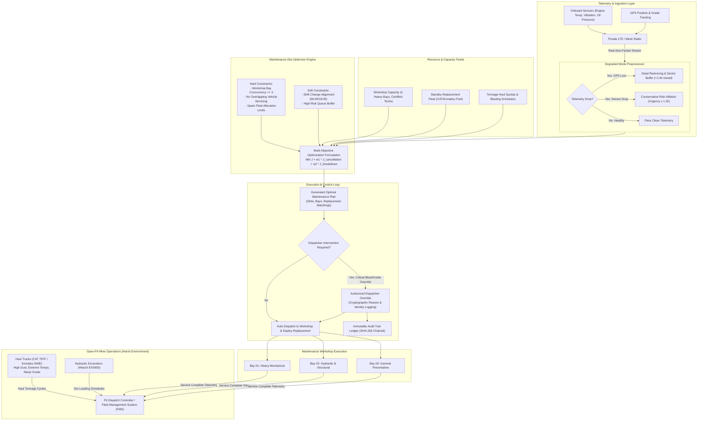

# End-to-End Field Workflow Map & Architecture

## Heavy Mining Fleet Maintenance-Slot Optimisation under Harsh Conditions

## Detailed Field Workflow Stages

### Stage 1: Mine Pit Operation & Harsh Environmental Stress Monitoring
- Heavy vehicles operate under sustained harsh conditions: ambient temperatures reaching 49°C, dust particulate concentration $>600\,\mu\text{g/m}^3$, haul road inclines up to $14\%$, and heavy vibration.
- Traditional systems monitor only component operating hours. Our workflow ingests real-time stress telemetry to dynamically compute urgency scores.

### Stage 2: Telemetry Ingestion & Degraded State Resilience
- Heavy mining pits suffer frequent wireless blackouts, deep pit shading (GPS loss), and dust-fouled sensor dropouts.
- When GPS is lost, the preprocessor triggers **Dead Reckoning & Sector Defaulting**, adding safety transit buffers.
- When sensor telemetry drops, a **Conservative Risk Multiplier (1.25×)** is applied to avoid catastrophic failure in the haul cycle.

### Stage 3: Multi-Objective Slot Optimization
- Concurrently evaluates:
  1. **Operational Cancellation Impact ($J_1$)**: Cost of taking high-payload trucks out of production during critical haulage cycles, mitigated by dynamically dispatching standby replacement vehicles.
  2. **Catastrophic Breakdown Risk ($J_2$)**: Exponential risk cost of operating deteriorated equipment in high-stress pit zones.
- Enforces strict hard constraints on physical bay capacity and crew availability while honoring soft shift preferences.

### Stage 4: Dispatcher Override & Immutable Audit Governance
- Mining superintendents retain the authority to override automated slotting (e.g., deferring service during mandatory blast clearance).
- All overrides require formal credentials and operational justifications, recorded in a tamper-proof SHA-256 chained audit ledger.
